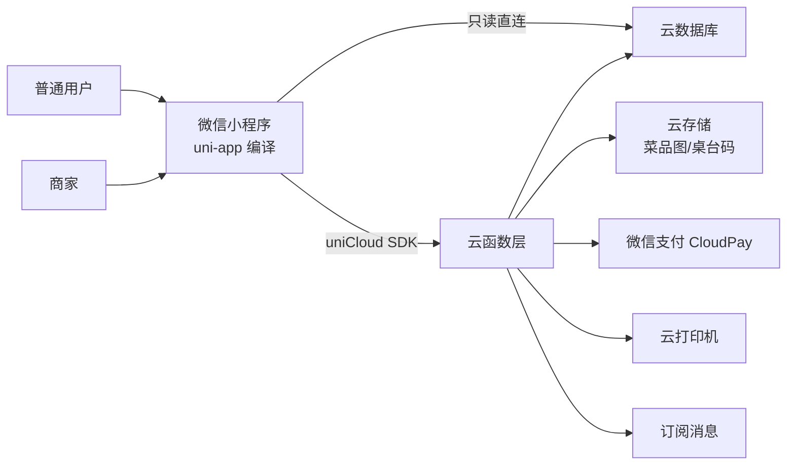
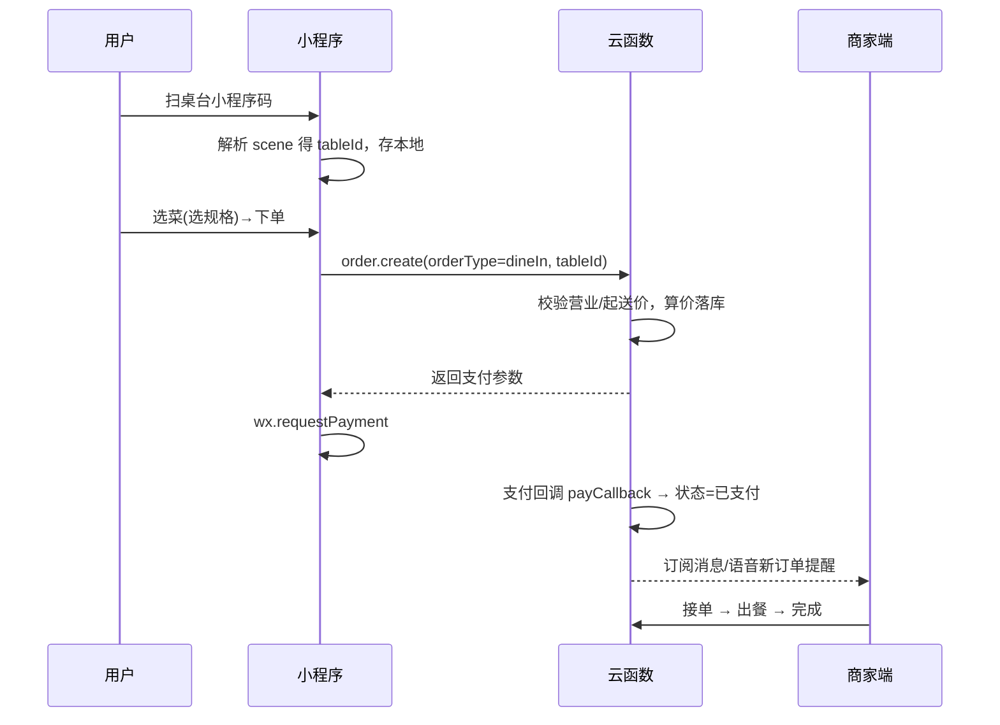
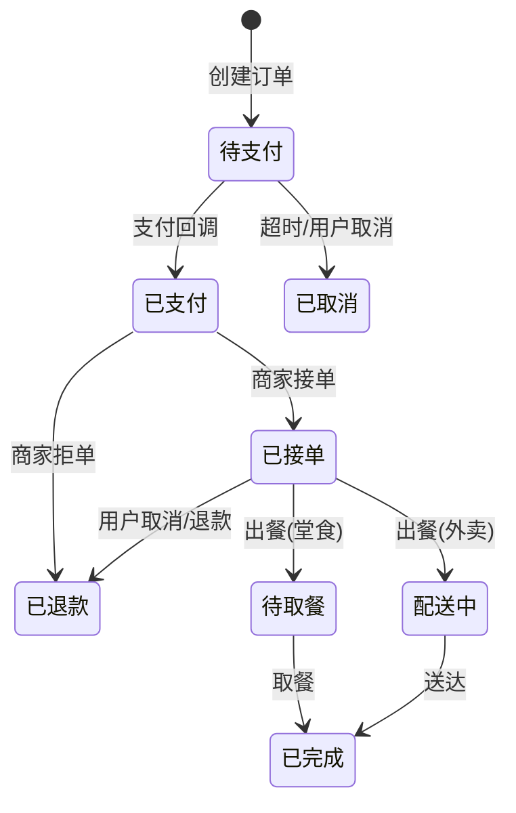

# 点餐小程序 · 设计文档

> 版本：v1.0
> 日期：2026-10-09
> 技术栈：uni-app + 微信云开发（腾讯云 CloudBase）

---

## 1. 项目概述

一个面向单一门店的在线点餐小程序，用户端完成「浏览菜单 → 加购 → 下单 → 微信支付 → 取餐/收货」，商家端（**对普通用户完全隐藏**）完成「菜品管理、订单处理、桌台管理、营业设置、数据统计与小票打印」。

核心特征：

- **双角色同端**：普通用户和商家共用一个小程序，商家通过隐藏入口 + 身份校验进入管理界面，普通用户看不到任何管理入口。
- **两种点餐场景**：堂食（扫码绑定桌台）与外卖（填写地址配送）。
- **多规格菜品**：支持大小份、辣度、温度、加料等 SKU 属性组合定价。

---

## 2. 技术选型

| 层 | 选型 | 说明 |
|---|---|---|
| 前端框架 | uni-app（Vue 3） | 编译到微信小程序；未来可复用编译 H5 / App |
| 后端 | 微信云开发（CloudBase） | 云函数 + 云数据库 + 云存储，免服务器免运维 |
| 数据库 | 云数据库（文档型 NoSQL） | 集合即表，字段自由扩展 |
| 服务端逻辑 | 云函数（Node.js） | 所有写操作、支付、权限校验走云函数 |
| 登录 | 微信 openid | 云开发天然获取 openid，无需自建账号体系 |
| 支付 | 微信支付（云开发 CloudPay） | 云函数统一下单，客户端 `requestPayment` 拉起 |
| 图片/文件 | 云存储 | 菜品图、桌台二维码 |
| 小票打印 | 第三方云打印机（飞鹅/易联云） | 云函数内 HTTP 调用 |

> **说明**：uni-app 通过 `uniCloud`（腾讯云空间）调用微信云开发；腾讯云空间的底层即微信云开发（CloudBase），编译到微信小程序时与 `wx.cloud` 互通。若后续仅限微信小程序，也可直接使用 `wx.cloud`。

---

## 3. 系统架构



### 3.1 分层职责

- **小程序端**：页面渲染、购物车、交互、拉起支付；商家端页面 + 登录态判断。
- **云函数**：登录/注册、菜品/分类/桌台/订单/设置的全部写操作、金额计算、支付下单与回调、权限校验、统计聚合、打印与消息推送。
- **云数据库**：所有业务数据。
- **云存储**：菜品图片、桌台二维码图片。

### 3.2 数据访问权限策略

| 数据 | 客户端直读 | 说明 |
|---|---|---|
| 分类 / 菜品 / 桌台（公开字段） | ✅ 允许 | 安全规则设「所有用户可读」，加快加载 |
| 订单 / 用户 / 设置 / 统计 | ❌ 禁止 | 一律走云函数，云函数以管理员身份读写 |

所有**写操作**必须走云函数；云函数内部二次校验 openid 与角色。

---

## 4. 角色与权限

| 角色 | 判定方式 | 可访问功能 |
|---|---|---|
| 普通用户 | 所有微信用户（默认） | 点餐、支付、查看自己的订单、个人中心 |
| 商家 | `users` 集合中 `role = 'merchant'`（openid 白名单） | 商家管理页（菜品/订单/桌台/设置/统计/打印） |

### 4.1 商家入口的「隐藏」设计

1. **前端隐藏**：用户可见页面不出现任何商家入口；仅在「个人中心」埋一个无文案的触发点（如连续点击版本号 5 次），或进入后需再验证。
2. **后端校验（关键）**：所有 `merchant-*` 云函数第一步校验 `openid` 是否在商家白名单（`users.role === 'merchant'`），否则返回 `403`。**前端隐藏只是第一道门，云端校验才是真正的权限边界**。
3. **首次开通商家**：部署后，运营人员在云数据库 `users` 中手动将目标用户的 `openid` 标记为 `merchant`，或小程序内输入一次性「管理码」绑定 openid（管理码存于云数据库 `settings`，用后作废）。

---

## 5. 功能需求

### 5.1 用户端

| 模块 | 功能点 |
|---|---|
| 首页/菜单 | 轮播图、分类导航、菜品列表（含多规格）、菜品详情 |
| 购物车 | 加购（选规格）、改数量、删除、合计金额 |
| 下单结算 | 选择堂食（已扫码绑桌）/ 外卖（填地址、配送费、起送价校验） |
| 支付 | 微信支付；支付成功/失败处理；支付回调更新订单 |
| 订单 | 我的订单列表、订单详情、状态流转、取消/退款入口 |
| 个人中心 | 微信授权登录、头像昵称、手机号、历史订单 |

### 5.2 商家端（用户不可见）

| 模块 | 功能点 |
|---|---|
| 菜品管理 | 分类增删改、菜品上传（图/名称/描述）、**多规格配置**、价格、上下架、库存 |
| 订单管理 | 新订单提醒（订阅消息/语音）、接单、拒单、出餐、完成、退款 |
| 桌台管理 | 桌号增删改、生成/下载桌台二维码、桌台占用状态 |
| 营业设置 | 营业开关、营业时间、起送价、配送费、是否接单 |
| 统计 | 营收统计、销量排行、按日/时段统计（云函数聚合） |
| 打印 | 下单后自动出小票（云打印机），可补打 |

---

## 6. 数据库设计（云数据库集合）

> 金额统一以**「分」为单位的整数**存储，避免浮点误差。时间存 `Date`。

### 6.1 `users` — 用户

```js
{
  _id,                 // openid 作为唯一标识（或独立字段）
  openid,              // 微信 openid（云函数自动注入）
  nickname,            // 昵称
  avatar,              // 头像 fileID/URL
  phone,               // 手机号（授权获取）
  role: 'user',        // 'user' | 'merchant'
  createdAt,           // Date
  lastLoginAt
}
```

### 6.2 `categories` — 菜品分类

```js
{
  _id,
  name,                // 分类名，如「招牌」「主食」「饮品」
  sort,                // 排序权重
  isOn: true           // 是否显示
}
```

### 6.3 `dishes` — 菜品（含多规格）

```js
{
  _id,
  categoryId,
  name,
  image,               // 云存储 fileID
  description,
  isOnSale: true,      // 上/下架
  sort,
  // —— 多规格 ——
  specs: [             // 规格组
    { name: '份量', options: ['小份', '大份'] },
    { name: '辣度', options: ['不辣', '微辣', '中辣', '特辣'] }
  ],
  skus: [              // 规格组合 + 独立定价
    {
      attrs: { '份量': '小份', '辣度': '不辣' },  // 组合键值
      price: 1800,     // 分
      stock: 999,      // 库存，-1 表示不限
      isOn: true
    }
  ],
  sales,               // 累计销量（用于排行）
  createdAt, updatedAt
}
```

### 6.4 `tables` — 堂食桌台

```js
{
  _id,
  no: 'A01',           // 桌号（可读）
  qrCode: 'cloud://...', // 小程序码 fileID
  status: 'free',      // 'free' | 'occupied'（绑定订单后占用）
  capacity: 4,         // 座位数（可选）
  isOn: true
}
```

### 6.5 `orders` — 订单

```js
{
  _id,
  orderNo,             // 展示用订单号，如 20261009 + 随机
  userId,              // 下单用户 openid
  orderType,           // 'dineIn' | 'delivery'
  // 堂食
  tableId, tableNo,
  // 外卖
  address: { name, phone, detail },  // 收货信息
  remark,              // 备注（辣度/少糖等文字）

  items: [             // 订单明细（落库时展开，避免菜品改价影响历史单）
    {
      dishId, name, image,
      attrs: { '份量': '大份', '辣度': '中辣' },
      price,           // 单价（分）
      qty
    }
  ],
  goodsAmount,         // 商品总额（分）
  deliveryFee,         // 配送费（分，堂食为 0）
  totalAmount,         // 应付（分）
  status,              // 见状态机
  payInfo: {           // 支付信息
    transactionId,     // 微信支付单号
    paidAt
  },
  createdAt, updatedAt,
  cancelReason,        // 取消/拒单原因
  refund: {            // 退款信息（可选）
    refundId, amount, status, at
  }
}
```

### 6.6 `settings` — 店铺设置（单店，一条记录）

```js
{
  _id,
  shopName, logo, phone,
  isOpen: true,        // 营业总开关
  businessHours: { start: '08:00', end: '22:00' },
  minDelivery: 2000,   // 起送价（分）
  deliveryFee: 500,    // 配送费（分）
  notice: '',          // 店铺公告
  merchantKey: ''      // 一次性管理码（商家开通用）
}
```

### 6.7 `banners` — 首页轮播图（可选）

```js
{ _id, image, link, sort, isOn }
```

---

## 7. 云函数与接口设计

> 约定：云函数统一入参 `event = { action, ...payload }`；返回 `{ code, data, message }`。

### 7.1 云函数清单

| 云函数 | 职责 | 关键 action |
|---|---|---|
| `user` | 登录/注册/角色 | `login`, `getProfile`, `updateProfile`, `bindPhone`, `bindMerchant` |
| `dish` | 菜品与分类 | `listCategories`, `listDishes`, `getDish`（用户端只读可直连）；`saveCategory`, `saveDish`, `toggleDish`（商家写） |
| `order` | 下单与支付 | `create`（算价+落库+统一下单）、`cancel`、`payCallback` |
| `merchant` | 商家管理 | `listOrders`, `acceptOrder`, `rejectOrder`, `finishOrder`, `saveTable`, `genTableQR`, `saveSettings`, `stats` |
| `print` | 小票打印 | `printOrder`, `reprint` |
| `notify` | 消息/语音 | `sendSubscribeMessage`（可并入 order/merchant） |

### 7.2 关键接口示例

**用户端**

| 接口 | 说明 |
|---|---|
| `user.login` | 用 `cloud.getWXContext()` 拿 openid，无记录则建用户，返回角色 |
| `order.create` | 入参：`orderType`, `items`, `tableId`/`address`；服务端重算金额、校验营业状态与起送价，落库后调用 CloudPay 下单 |
| `order.cancel` | 未支付/已支付未接单可取消；已支付走退款 |

**商家端（全部先校验 `role==='merchant'`）**

| 接口 | 说明 |
|---|---|
| `merchant.listOrders` | 按状态/日期/类型筛选，分页 |
| `merchant.acceptOrder` / `rejectOrder` | 接单/拒单（拒单自动退款） |
| `merchant.finishOrder` | 出餐/完成；堂食标记「待取餐」，外卖标记「配送中/完成」 |
| `merchant.saveTable` / `genTableQR` | 桌台增删改；生成小程序码存云存储 |
| `merchant.saveSettings` | 营业设置 |
| `merchant.stats` | 用 aggregate 聚合：当日/区间营收、销量 TOP N |

---

## 8. 页面与路由设计

```
pages/
├── index/                # 首页：轮播 + 分类 + 菜品列表
├── dish/                 # 菜品详情（选规格）
├── cart/                 # 购物车
├── checkout/             # 结算（堂食/外卖切换）
├── address/              # 外卖地址管理
├── order-detail/         # 订单详情
├── orders/               # 我的订单
├── mine/                 # 个人中心（隐藏商家入口埋点）
│
└── merchant/             # ★ 商家管理（用户看不到）
    ├── login/            # 商家登录/管理码绑定
    ├── home/             # 商家工作台
    ├── dish-manage/      # 菜品列表 + 编辑（多规格）
    ├── category-manage/  # 分类管理
    ├── order-manage/     # 订单处理（接单/出餐）
    ├── table-manage/     # 桌台 + 二维码
    ├── settings/         # 营业设置
    └── stats/            # 统计报表
```

> 商家页通过 `pages.json` 的 `condition`/分包（subPackages）加载；进入商家工作台前先 `user.login` 校验 `role`，非商家直接退出。

---

## 9. 关键流程

### 9.1 堂食扫码点餐



### 9.2 外卖配送

下单时 `orderType='delivery'`，校验 `address` + 起送价 + 配送费；状态机多「配送中」环节。

### 9.3 微信支付（云开发 CloudPay）

1. `order.create` 云函数内：`cloud.cloudPay.unifiedOrder({ body, outTradeNo: orderNo, totalFee: totalAmount, ... })` 生成支付参数。
2. 小程序端 `uni.requestPayment(provider='wxpay', ...)` 拉起支付。
3. 支付结果以 **支付回调云函数**（`order.payCallback`）为准更新订单状态，前端结果页仅作提示，避免「前端回调可信」漏洞。

---

## 10. 订单状态机



---

## 11. 桌台二维码生成

1. 商家在 `table-manage` 新增桌台，调 `merchant.genTableQR`。
2. 云函数用云调用 `cloud.openapi.wxacode.getUnlimited({ scene: 't='+tableId, page: 'pages/index/index' })` 生成小程序码。
3. 上传云存储，`fileID` 回写 `tables.qrCode`；商家可下载图片打印贴桌。
4. 用户扫码进入，`onLoad(options)` 读 `options.scene` 解析 `tableId`，写入本地并进入堂食模式。

---

## 12. 安全与权限

- **权限边界在云端**：所有商家写接口云函数内校验 `role === 'merchant'`。
- **金额不可信前端**：下单金额由云函数按 `dishes.skus` 重新计算，绝不信任前端传入的总额。
- **历史订单不可变**：订单明细在创建时展开快照（名称/价格/规格），菜品改价不影响已下单。
- **越权访问**：用户订单查询只允许查自己的 `userId`；商家查询需校验角色。
- **数据库安全规则**：敏感集合禁止客户端直连，仅云函数访问。
- **支付安全**：以支付回调为准更新状态；回调验签由 CloudPay 内部处理。

---

## 13. 打印与消息提醒

- **语音提醒**：商家端收到新订单时，`uni.createInnerAudioContext()` 播放提示音（保持前台时有效）。
- **订阅消息**：商家订阅「新订单通知」，用户订阅「订单状态变更/取餐提醒」；由云函数调 `subscribeMessage.send` 推送。
- **小票打印**：云函数在 `acceptOrder` 后调用云打印机 API（飞鹅/易联云）出票；`reprint` 支持补打。

---

## 14. 目录结构

```
AIFoodOrdering/
├── pages/                      # 页面（见 §8）
├── static/                     # 静态资源（图标、tab 图）
├── uniCloud-tcb/               # 云开发（腾讯云空间）
│   └── cloudfunctions/
│       ├── user/
│       ├── dish/
│       ├── order/
│       ├── merchant/
│       ├── print/
│       └── notify/
├── components/                 # 通用组件（菜品卡片、规格选择器、购物车浮层）
├── utils/                      # 请求封装、金额工具、常量
├── App.vue
├── main.js
├── manifest.json               # uni-app 配置（appid、uniCloud 空间）
├── pages.json                  # 页面/路由/分包
└── 设计文档.md
```

---

## 15. 开发里程碑

| 阶段 | 内容 | 产出 |
|---|---|---|
| M1 基础 | 云开发环境、用户登录、分类/菜品（含多规格）读写 | 能浏览菜单 |
| M2 下单 | 购物车、订单创建、堂食桌台 + 二维码 | 能堂食下单 |
| M3 支付 | CloudPay 下单、回调、订单状态机 | 能在线支付 |
| M4 商家端 | 商家入口 + 角色校验 + 菜品/订单/桌台/设置管理 | 商家可运营 |
| M5 增强 | 外卖配送、统计、订阅消息、小票打印 | 完整闭环 |

---

## 16. 待确认事项（后续可补充）

1. 云打印机的具体品牌/型号（飞鹅 / 易联云）。
2. 订阅消息模板 ID（需在小程序后台申请）。
3. 微信支付商户号资质（需「微信支付商户号」，CloudPay 需要开通云开发微信支付能力）。
4. 是否需要优惠券 / 满减 / 会员等功能（未列入本期）。
5. 桌台二维码的固定桌号 vs 动态（翻台）策略。
